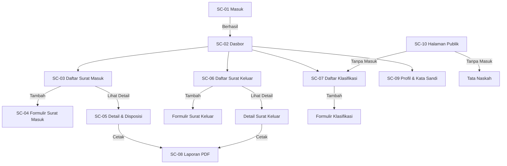

# Wireframe SISIPIN DISHUB

**Versi:** 1.0  
**Tanggal:** 21 Oktober 2026  
**Penanggung jawab:** Arta Eka Yuly Rajagukguk (Frontend)  
**Cabang:** `docs/2.3.2-wireframe-halaman-publik-dan-autentikasi`  
**Issue grup:** `[2.3] Perancangan Antarmuka (UI/UX)`  
**Rujukan WBS:** 2.3.2, 2.3.3, 2.3.4  

---

## Daftar Isi

1. [Panduan Visual](#panduan-visual)
2. [Catatan Aksesibilitas](#catatan-aksesibilitas)
3. [Istilah dari Glosarium](#istilah-dari-glosarium)
4. [Daftar Layar](#daftar-layar)
5. [Tautan Gambar Wireframe](#tautan-gambar-wireframe)

---

## Panduan Visual

### Palet Warna

| Peran | Kode Hex | Keterangan |
|-------|----------|------------|
| Primer Utama | `#1B4F72` | Biru dinas, header, tombol utama, tautan aktif |
| Primer Gelap | `#0D2B3E` | Navigasi sidebar, teks judul utama |
| Primer Terang | `#E8F1F8` | Latar belakang kartu statistik, badge aktif |
| Sekunder | `#F5F0E1` | Krem hangat, latar halaman publik, tata naskah |
| Sukses | `#2E7D32` | Tombol simpan, status selesai, notifikasi berhasil |
| Peringatan | `#F9A825` | Status diproses, peringatan batas waktu |
| Bahaya | `#C62828` | Tombol hapus, status ditolak, notifikasi galat |
| Netral Gelap | `#212121` | Teks badan utama |
| Netral Sedang | `#616161` | Teks bantuan, label non-aktif |
| Netral Terang | `#F5F5F5` | Garis pemisah, latar input tidak aktif |
| Putih | `#FFFFFF` | Latar kartu, modal, halaman autentikasi |

> **Catatan kontras:** Semua kombinasi teks pada latar memenuhi rasio WCAG AA minimal 4.5:1 untuk teks biasa dan 3:1 untuk teks besar (≥ 18 px atau ≥ 14 px tebal).

### Tipografi

| Elemen | Jenis Huruf | Ukuran | Tinggi Baris | Berat |
|--------|-------------|--------|--------------|-------|
| Judul Halaman (H1) | Inter | 24 px (360 px) / 28 px (1366 px) | 1.3 | 700 |
| Judul Bagian (H2) | Inter | 20 px / 22 px | 1.3 | 600 |
| Judul Kartu (H3) | Inter | 16 px / 18 px | 1.4 | 600 |
| Teks Badan | Inter | 14 px / 15 px | 1.6 | 400 |
| Teks Kecil / Bantuan | Inter | 12 px / 13 px | 1.5 | 400 |
| Tombol / Label Input | Inter | 14 px / 15 px | 1.5 | 500 |
| Kode / Monospace | JetBrains Mono | 13 px / 14 px | 1.5 | 400 |

> **Skala responsif:** Gunakan `clamp(14px, 0.875rem + 0.15vw, 15px)` untuk teks badan agar menyesuaikan lebar layar tanpa lompatan tajam.

### Jarak (Spacing)

| Token | Nilai | Penggunaan |
|-------|-------|------------|
| `space-1` | 4 px | Jarak ikon-teks, padding badge |
| `space-2` | 8 px | Padding dalam tombol, jarak item daftar |
| `space-3` | 12 px | Padding kartu, jarak label-input |
| `space-4` | 16 px | Padding halaman, jarak antar kartu |
| `space-5` | 24 px | Jarak seksi, margin atas/bawah tabel |
| `space-6` | 32 px | Jarak mayor, padding modal |

> **Aturan:** Selalu gunakan kelipatan 4 px. Hindari nilai hard-coded di CSS; pakai variabel Tailwind `space-y-4`, `p-4`, `gap-4`.

### Tombol

| Variasi | Latar | Teks | Hover | Fokus | Dinonaktifkan |
|---------|-------|------|-------|-------|---------------|
| Utama | `#1B4F72` | Putih | `#0D2B3E` | Ring `#1B4F72` 3px | `#90CAF9` |
| Sekunder | Transparan | `#1B4F72` | `#E8F1F8` | Ring `#1B4F72` 3px | Netral Terang |
| Bahaya | `#C62828` | Putih | `#B71C1C` | Ring `#C62828` 3px | `#EF9A9A` |
| Teks | Transparan | `#1B4F72` | `#E8F1F8` | Ring `#1B4F72` 3px | Netral Sedang |

- **Ukuran minimal area klik:** 44 × 44 px (sesuai WCAG 2.5.5)
- **Padding horizontal:** 16 px (mobile) / 24 px (desktop)
- **Radius:** 6 px
- **Transisi:** 150 ms ease-out

### Formulir

| Elemen | Spesifikasi |
|--------|-------------|
| Label | Di atas input, tebal 500, jarak 8 px ke input |
| Input teks / select / textarea | Tinggi 40 px (mobile) / 44 px (desktop), padding 12 px horizontal, border 1 px `#BDBDBD`, radius 6 px |
| Fokus | Border `#1B4F72` 2 px, ring `#1B4F72` 3 px, hapus outline bawaan |
| Galat | Border `#C62828`, teks bantuan berwarna `#C62828`, ikon peringatan |
| Berhasil | Border `#2E7D32` (opsional, untuk validasi langsung) |
| Placeholder | Warna `#9E9E9E`, tidak menggantikan label |
| Bantuan | Di bawah input, ukuran 12 px, warna `#616161` |
| Kelompok terkait | `fieldset` + `legend` (untuk radio/checkbox) |

### Tabel

| Properti | Nilai |
|----------|-------|
| Header | Latar `#E8F1F8`, teks `#1B4F72`, tebal 600, padding 12 px |
| Baris ganjil | Latar `#FFFFFF` |
| Baris genap | Latar `#FAFAFA` |
| Hover baris | Latar `#E8F1F8` |
| Garis pemisah | `#E0E0E0` 1 px |
| Sel kosong | Teks `#9E9E9E`, miring |
| Tindakan | Ikon 20 px, tooltip, area klik 44 px |

### Notifikasi

| Jenis | Latar | Teks | Ikon | Posisi |
|-------|-------|------|------|--------|
| Sukses | `#E8F5E9` | `#2E7D32` | Ceklis lingkaran | Toast kanan atas / inline |
| Informasi | `#E3F2FD` | `#1565C0` | Info lingkaran | Toast kanan atas / inline |
| Peringatan | `#FFF8E1` | `#F57F17` | Segitiga peringatan | Toast kanan atas / inline |
| Galat | `#FBE9E7` | `#C62828` | Silang lingkaran | Toast kanan atas / inline |

- Toast hilang otomatis setelah 5 detik (kecuali galat).
- Inline notifikasi tetap hingga pengguna menutup atau memperbaiki.

---

## Catatan Aksesibilitas

| Aspek | Ketentuan |
|-------|-----------|
| **Kontras teks** | Minimal 4.5:1 (teks biasa), 3:1 (teks besar ≥ 18 px atau ≥ 14 px tebal) |
| **Ukuran klik minimal** | 44 × 44 px untuk semua elemen interaktif (tombol, tautan, ikon, checkbox, radio) |
| **Label formulir** | Setiap input memiliki `<label>` eksplisit dengan `for` = `id` input; tidak pakai `placeholder` sebagai gantinya |
| **Navigasi papan ketik** | Semua elemen interaktif erreichable via `Tab`; urutan logis (kiri-kanan, atas-bawah); fokus terlihat jelas (ring 3 px) |
| **Skip link** | Tautan "Lewati ke konten utama" di awal halaman, muncul saat fokus |
| **Heading hierarchy** | H1 → H2 → H3 berurutan, tidak melompat level |
| **ARIA** | `aria-live="polite"` untuk toast; `aria-expanded` pada dropdown; `aria-describedby` untuk bantuan/galat input |
| **Reduced motion** | Hormati `prefers-reduced-motion: reduce`; matikan animasi non-esensial |
| **Zoom** | Tampilan tetap fungsional hingga 200% zoom tanpa scroll horizontal pada 360 px |
| **Bahasa** | `lang="id"` pada `<html>`; istilah dari glosarium digunakan konsisten |

---

## Istilah dari Glosarium

Berikut istilah wajib yang digunakan pada layar (Bahasa Indonesia, **bukan** padanan Inggris):

| Istilah Glosarium | Dipakai pada Layar |
|-------------------|-------------------|
| **Masuk** | Halaman login, tombol "Masuk" |
| **Keluar** | Tombol keluar akun, menu pengguna |
| **Dasbor** | Halaman utama setelah masuk |
| **Surat Masuk** | Navigasi, judul tabel, formulir |
| **Surat Keluar** | Navigasi, tab SPT/SPPD/SK/Undangan |
| **Agenda Surat** | Nomor urut pencatatan (bukan "Nomor Indeks") |
| **Lampiran** | Unggah berkas, daftar berkas (bukan "Attachment") |
| **Disposisi** | Penerusan surat, formulir instruksi |
| **Instruksi** | Isian pada disposisi (bukan "Komentar" / "Note") |
| **Kode Klasifikasi** | Daftar klasifikasi, pencarian (bukan "Kategori" / "Tagging") |
| **Tata Naskah** | Halaman publik contoh naskah (bukan "Template") |
| **KP4** | Kartu pegawai, halaman profil |
| **Unggah** | Tombol/aksi unggah berkas (bukan "Upload") |
| **Unduh** | Tombol/aksi unduh berkas (bukan "Download") |
| **Cari** | Input pencarian (bukan "Search") |
| **Saring** | Dropdown/filter tabel (bukan "Filter") |
| **Laporan** | Pratinjau cetak, ekspor PDF (bukan "Report") |
| **Profil** | Halaman pengaturan pengguna |
| **Kata Sandi** | Formulir ganti kata sandi (bukan "Password") |
| **Pengelola Sistem** | Peran admin teknis (bukan "Super Admin") |
| **Kasubbag** | Peran atasan disposisi |
| **Staff Subbagian** | Peran pencatat surat |
| **Bidang** | Unit kerja (bukan "Departemen") |
| **Retensi** | Masa simpan arsip (bukan "Kadaluarsa") |
| **Arsip Aktif / Inaktif** | Status arsip (bukan "Hidup" / "Mati") |
| **Naskah Dinas** | Jenis dokumen resmi (bukan "Dokumen Resmi") |

---

## Daftar Layar

| No | Kode | Nama Layar | Berkas Deskripsi | Gambar Wireframe |
|----|------|------------|------------------|------------------|
| 1 | `SC-01` | Masuk | `sc-01-masuk.md` | [Excalidraw](https://excalidraw.com/#json=PLACEHOLDER_SC01) |
| 2 | `SC-02` | Dasbor | `sc-02-dasbor.md` | [Excalidraw](https://excalidraw.com/#json=PLACEHOLDER_SC02) |
| 3 | `SC-03` | Daftar Surat Masuk | `sc-03-daftar-surat-masuk.md` | [Excalidraw](https://excalidraw.com/#json=PLACEHOLDER_SC03) |
| 4 | `SC-04` | Formulir Surat Masuk + Unggah Lampiran | `sc-04-formulir-surat-masuk.md` | [Excalidraw](https://excalidraw.com/#json=PLACEHOLDER_SC04) |
| 5 | `SC-05` | Detail Surat & Disposisi | `sc-05-detail-disposisi.md` | [Excalidraw](https://excalidraw.com/#json=PLACEHOLDER_SC05) |
| 6 | `SC-06` | Daftar Surat Keluar per Jenis | `sc-06-daftar-surat-keluar.md` | [Excalidraw](https://excalidraw.com/#json=PLACEHOLDER_SC06) |
| 7 | `SC-07` | Daftar Kode Klasifikasi | `sc-07-daftar-klasifikasi.md` | [Excalidraw](https://excalidraw.com/#json=PLACEHOLDER_SC07) |
| 8 | `SC-08` | Laporan & Pratinjau Cetak PDF | `sc-08-laporan-pdf.md` | [Excalidraw](https://excalidraw.com/#json=PLACEHOLDER_SC08) |
| 9 | `SC-09` | Profil & Kata Sandi | `sc-09-profil-kata-sandi.md` | [Excalidraw](https://excalidraw.com/#json=PLACEHOLDER_SC09) |
| 10 | `SC-10` | Halaman Publik (Klasifikasi & Tata Naskah) | `sc-10-halaman-publik.md` | [Excalidraw](https://excalidraw.com/#json=PLACEHOLDER_SC10) |

> **Catatan:** Ganti `PLACEHOLDER_SCXX` dengan ID file Excalidraw/draw.io/Figma yang sebenarnya. Pastikan tautan dapat dibuka publik tanpa akun berbayar.

---

## Tautan Gambar Wireframe

Semua gambar wireframe dibuat menggunakan **Excalidraw** (direkomendasikan) atau **draw.io** / **Figma**. Format file: `.excalidraw` / `.drawio` / `.figma` disimpan di repositori atau tautan publik.

| Layar | Tautan Excalidraw | Tautan Draw.io | Tautan Figma |
|-------|-------------------|----------------|--------------|
| SC-01 Masuk | [🔗 Excalidraw](https://excalidraw.com/#json=SC01_ID) | [🔗 Draw.io](https://app.diagrams.net/#GSC01_ID) | [🔗 Figma](https://figma.com/file/SC01_ID) |
| SC-02 Dasbor | [🔗 Excalidraw](https://excalidraw.com/#json=SC02_ID) | [🔗 Draw.io](https://app.diagrams.net/#GSC02_ID) | [🔗 Figma](https://figma.com/file/SC02_ID) |
| SC-03 Daftar Surat Masuk | [🔗 Excalidraw](https://excalidraw.com/#json=SC03_ID) | [🔗 Draw.io](https://app.diagrams.net/#GSC03_ID) | [🔗 Figma](https://figma.com/file/SC03_ID) |
| SC-04 Formulir Surat Masuk | [🔗 Excalidraw](https://excalidraw.com/#json=SC04_ID) | [🔗 Draw.io](https://app.diagrams.net/#GSC04_ID) | [🔗 Figma](https://figma.com/file/SC04_ID) |
| SC-05 Detail & Disposisi | [🔗 Excalidraw](https://excalidraw.com/#json=SC05_ID) | [🔗 Draw.io](https://app.diagrams.net/#GSC05_ID) | [🔗 Figma](https://figma.com/file/SC05_ID) |
| SC-06 Daftar Surat Keluar | [🔗 Excalidraw](https://excalidraw.com/#json=SC06_ID) | [🔗 Draw.io](https://app.diagrams.net/#GSC06_ID) | [🔗 Figma](https://figma.com/file/SC06_ID) |
| SC-07 Daftar Klasifikasi | [🔗 Excalidraw](https://excalidraw.com/#json=SC07_ID) | [🔗 Draw.io](https://app.diagrams.net/#GSC07_ID) | [🔗 Figma](https://figma.com/file/SC07_ID) |
| SC-08 Laporan PDF | [🔗 Excalidraw](https://excalidraw.com/#json=SC08_ID) | [🔗 Draw.io](https://app.diagrams.net/#GSC08_ID) | [🔗 Figma](https://figma.com/file/SC08_ID) |
| SC-09 Profil & Kata Sandi | [🔗 Excalidraw](https://excalidraw.com/#json=SC09_ID) | [🔗 Draw.io](https://app.diagrams.net/#GSC09_ID) | [🔗 Figma](https://figma.com/file/SC09_ID) |
| SC-10 Halaman Publik | [🔗 Excalidraw](https://excalidraw.com/#json=SC10_ID) | [🔗 Draw.io](https://app.diagrams.net/#GSC10_ID) | [🔗 Figma](https://figma.com/file/SC10_ID) |

> **Instruksi:** Setelah membuat wireframe di Excalidraw/draw.io/Figma, publikasikan sebagai tautan hanya-baca (view-only) dan perbarui tabel di atas serta berkas deskripsi masing-masing layar.

---

## Alur Navigasi Utama

---

## Catatan Implementasi untuk Backend (Nabila)

1. **Kontrak rute** — Gunakan nama rute Laravel yang konsisten dengan nama layar:
   - `login` → `masuk`
   - `dashboard` → `dasbor`
   - `surat-masuk.index`, `surat-masuk.create`, `surat-masuk.show`, `surat-masuk.edit`
   - `surat-keluar.index`, `surat-keluar.create`, `surat-keluar.show`
   - `klasifikasi.index`, `klasifikasi.create`, `klasifikasi.edit`
   - `laporan.surat-masuk`, `laporan.surat-keluar`, `laporan.disposisi`
   - `profil.show`, `profil.password`
   - `publik.klasifikasi`, `publik.tata-naskah`

2. **Nama field formulir** — Ikuti glosarium untuk label, gunakan `snake_case` untuk nama field:
   - `nomor_agenda`, `tanggal_surat`, `tanggal_terima`, `asal_surat`, `perihal`, `kode_klasifikasi`, `lampiran[]`, `instruksi`, `tindak_lanjut_oleh`

3. **Validasi** — Pesan galat dalam Bahasa Indonesia, jelaskan tindakan berikutnya (bukan kode teknis).

4. **Paginasi** — Default 15 baris per halaman; opsi 10, 25, 50.

5. **Hak akses** — Rujuk matriks peran di glosarium: Kasubbag, Staff Subbagian, Pengelola Sistem.

---

## Riwayat Perubahan

| Versi | Tanggal | Perubahan | Oleh |
|-------|---------|-----------|------|
| 1.0 | 21 Okt 2026 | Versi awal: panduan visual, aksesibilitas, glosarium, 10 layar, tautan wireframe | Arta |

---

## Lampiran

- Setiap layar memiliki berkas deskripsi terpisah di folder `docs/wireframe/` dengan format `sc-XX-nama-layar.md`.
- Berkas deskripsi berisi: tujuan layar, elemen utama, keadaan kosong, keadaan galat, catatan 360 px & 1366 px.
- Gambar wireframe asli (`.excalidraw` / `.drawio`) disarankan disimpan di folder `docs/wireframe/assets/` atau tautan cloud publik.